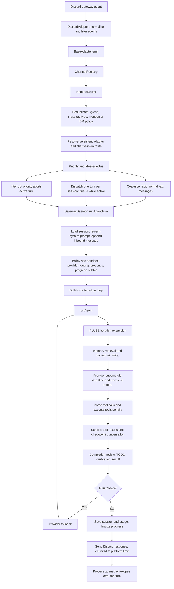

# Symbiote Agent Loop and Discord Path Map

Reviewed: 2026-10-24

This is a source-grounded map of the production agent path, including the Discord
adapter, session routing, runner, tools, persistence, presence, and delivery.
It describes the current source flow rather than generated `dist` output.

## System at a glance

## Inbound: Discord event to agent turn

1. **Discord connection and events — `src/channels/adapters/discord.ts`.**
   `DiscordAdapter.platformConnect` constructs the discord.js client and wires
   `MessageCreate`, `MessageUpdate`, `MessageDelete`, reactions, and slash
   interactions. `handleMessage` ignores the bot itself and unrelated bots,
   then builds normalized source and payload objects. Message edits use payload
   type `edit`; reactions and deletions have their own types.
2. **Adapter envelope — `src/channels/adapter.ts`.**
   `BaseAdapter.emit` adds an envelope UUID, timestamp, source, normalized
   payload, and the platform message ID, then invokes the registry callback.
3. **Routing and policy — `src/channels/registry.ts`,
   `src/channels/router.ts`.**
   The registry passes adapter events to `InboundRouter.route`. The router
   rejects duplicate platform IDs, `@end`, and payload types other than text,
   media, or system. Discord DMs follow DM policy; guild channels and threads
   must mention this bot's configured ID. A persistent adapter+chat route maps
   the conversation to one session. Owner messages can receive high or interrupt
   priority.
4. **Queue and per-session serialization — `src/channels/bus.ts`,
   `src/gateway/daemon.ts`.**
   The daemon subscribes to known routes in `startMessageLoop`. Normal rapid
   text messages can be coalesced for the bus's two-second window. Active
   sessions queue later envelopes; interrupt envelopes bypass the queue and
   abort the active turn. `runAgentTurn` marks the session active before its
   first asynchronous work and drains pending envelopes after cleanup.
5. **Discord event caveat.** Although the adapter emits message-edit and
   reaction/delete events, `InboundRouter.route` intentionally filters them
   out of the reasoning loop. They do not create another assistant turn.

## Agent turn and model/tool loop

1. **Turn setup — `src/gateway/daemon.ts`, `runAgentTurn`.**
   The daemon constructs a sandbox context, marks channel/session activity,
   loads or creates the session, refreshes the workspace-aware system prompt,
   appends the inbound message, and creates a per-turn TODO scope and BLINK
   controller. Provider routing (PARC) chooses the primary route; tool calls
   execute through the sandboxed registry.
2. **Provider contract — `src/providers/types.ts`.**
   Providers consume normalized `Message[]`, tool schemas, and request config,
   and return an async stream of text, thinking, tool-call, usage, and done
   events. The runner does not depend on a provider-specific SDK.
3. **Iteration loop — `src/agent/runner.ts`, `runAgent`.**
   Each iteration updates the scoped checklist, checks abort/policy/context
   budgets, retrieves transient memory, trims context, adjusts temperature if
   enabled, and opens a provider stream. Idle timeouts and transient stream
   retries are handled around that stream. Tool JSON is assembled and parsed
   before execution; malformed arguments are reported as tool errors, not run
   as empty successful calls.
4. **Tool execution and checkpoints — `src/agent/runner.ts`.**
   Tool calls are executed sequentially in model emission order. Each tool has
   an execution timeout and abort signal; outputs are clipped and sanitized.
   Tool results are appended to the transcript and checkpointed after the
   batch, so a later provider fallback resumes from the saved conversation.
   Tool-start callbacks report progress; tool completion does not independently
   append an operational-progress line.
5. **Completion / continuation.**
   Tool-backed work receives at most one completion review per turn. Empty
   replies after tool work are nudged a bounded number of times. An unchanged
   open TODO list is returned rather than repeatedly re-injected. A changed
   open checklist is re-presented for continuation; blocked tasks get one
   blocker review. Iteration exhaustion returns a continuation result.
6. **PULSE and BLINK — `src/agent/pulse.ts`,
   `src/agent/blink.ts`, `src/gateway/daemon.ts`.**
   PULSE begins from the configured iteration cap (default 100), expands a
   long run to 1,000, and can return to baseline after three light sessions.
   BLINK preserves continuation state and starts a fresh runner budget when
   exhausted. Its default maximum depth is unlimited; checkpoints are periodic
   and a short cooldown separates continuations.
7. **Persistence and delivery — `src/sessions/manager.ts`,
   `src/gateway/daemon.ts`.**
   Runner checkpoints update the live session and save it. Normal completion
   saves the final transcript and usage, then the daemon finalizes the progress
   bubble and sends the response. Discord's `platformSend` formats and chunks
   long responses; only the first chunk replies to the original platform
   message.

## Discord operational activity vs typing

- **Typing** is separate from the status/activity text. The gateway calls
  `PresenceManager.startTyping` only when streamed user-facing text begins;
  thinking, reasoning, and tool starts stop typing. `DiscordAdapter.typing`
  calls `channel.sendTyping()`.
- **Rich activity** is a Discord bot-wide `Playing` activity because Discord
  bots cannot set user-style custom status. `PresenceManager` derives it from
  thinking/reasoning/writing/tool activity and fans it out to registered
  Discord clients. When multiple channels run concurrently, only one activity
  can be shown; current selection prioritizes executing tools, then response
  writing, then reasoning, then thinking, using the most recently updated
  activity within each priority.
- **Tool progress** is the editable `ToolProgressBubble` in
  `src/channels/progress-bubble.ts`, created once per channel turn by the
  daemon. It appends tool starts and completed TODO updates, throttles edits,
  and collapses to one final summary. The final assistant answer is a separate
  outbound message and is not a progress edit.

## Fresh-review findings and changes made

1. **Duplicate final progress edit (fixed).** If another tool-start event was
   queued while the initial progress send was pending, finalization could wait
   for that flush to edit the final summary, then force the identical summary
   edit a second time. `ToolProgressBubble` now remembers its last successfully
   rendered content and skips an identical edit. A concurrency regression test
   covers this exact ordering.
2. **Discord reconnect lost adapter configuration (fixed).**
   `platformReconnect` previously recreated the client with only the token,
   dropping `channelId` and `siblingBotIds`. The adapter now retains and reuses
   its connection configuration.
3. **Rich presence stayed bound to the old Discord client after reconnect
   (fixed).** The daemon previously registered presence only for the initial
   client. The adapter now notifies ready handlers for each client generation,
   so presence re-registers after reconnect.
4. **Concurrent Discord turns could report the wrong global activity (fixed).**
   Presence previously held one unscoped activity and one global tool-end
   timer. A tool finishing in one channel could set the bot to “Thinking” while
   another channel was still executing. Activity and completion timers are now
   scoped per adapter/chat; the single bot-wide display prefers an active tool,
   then response writing, reasoning, and thinking.
5. **Duplicate Gateways corrupted persistence and fought over the port (fixed).**
   Runtime logs showed concurrent Gateway processes sharing one workspace:
   they both targeted port 3009 and the same `.session` files. The second
   process logged `EADDRINUSE`; overlapping session/telemetry writes logged
   `EPERM` on Windows rename. `startGateway` now takes an exclusive
   workspace-level instance lock and refuses a second writer before Gateway
   startup.
6. **The Windows launcher missed relative-path Gateways and accepted a foreign
   health response (fixed).** Cleanup only matched absolute `dist` paths, so
   shell-launched `node dist/gateway/daemon.js` processes survived. The launcher
   then treated any HTTP 200 on the configured port as success, even when the
   desktop's own Gateway had failed with `EADDRINUSE`. Cleanup now traces
   workspace-aware parent commands and process records, and readiness verifies
   the Gateway PID and config written by that launch.
7. **The running `dist` was stale (fixed by clean rebuild).** The logged
   `require is not defined` stack originated in `dist/sessions/manager.js`,
   while the current source uses the ESM `node:fs` import. The supervisor also
   reported a missing built Gateway entry point. A clean production build
   restores `dist` from current source. The captured Gateway log contained no
   `EPIPE`; its exact origin cannot be confirmed from that log.

## Validation targets

- `src/test/progress-bubble.test.ts`: serialization, finalization and duplicate
  final-edit regression.
- `src/test/presence.test.ts`: activity state transitions, typing separation,
  and overlapping-channel tool activity.
- Discord adapter behavior: `src/channels/adapters/discord.ts` connect,
  reconnect, message event filtering, outbound splitting, and edit ownership.
- Type safety/build: `npm run build`.
