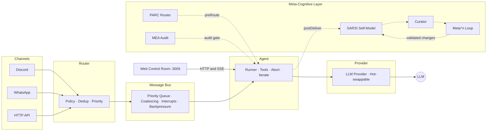

# Architecture

Symbiote is a single-process agent framework. The Node.js gateway manages channels, routing, sessions, tools, providers, and the HTTP control plane. The React web application is built separately and served by the gateway; the optional Electron desktop app connects to that local web interface.

## Data Flow

```
Channels → Router → Message Bus → Agent Runner → LLM Provider
   ↑                                    ↓          ↑
   └──────────── Response ──────────────┘          │
        ↑                                          │
   ┌────┴──────────────────────────────────────────┘
   │ Meta-Cognitive Layer (async, non-blocking)
   │ SARSI · Curator · Meta^n · MEA · PARC
   └──────────────────────────────────→ (learning feedback)
```



## Layers

| Layer | Responsibility |
|-------|---------------|
| **Channels** | Platform adapters (Discord, WhatsApp, HTTP). Receive messages, send responses. Adapter pattern — adding a new platform means implementing one interface. |
| **Router** | Policy enforcement, deduplication, JID normalization, interrupt detection, priority classification. Sits between channels and the bus. |
| **Message Bus** | Priority queue with interrupt bypass, message coalescing (merges rapid-fire messages), and backpressure management. The nervous system. |
| **Agent Runner** | The agentic loop — sends context to the LLM, processes tool calls, iterates until the model produces a final response or hits the iteration limit. |
| **Providers** | LLM backends — GitHub Copilot, Anthropic, OpenAI, Gladius. Hot-swappable mid-session. All implement the same `Provider` interface. |
| **Tools** | Built-in tools plus the MCP bridge for external tool servers. Access is mediated by the session trust tier and sandbox rules. |
| **Sessions** | Persistent conversation state, workspace and project metadata, and sub-agent runs. Tool access is classified per session and inherited by sub-agents where authorized. |
| **Web Control Room** | React/Vite application served by the gateway on `webPort` (default `3009`). Chat uses SSE for reasoning and activity events; answer text is delivered as a completed response rather than token-by-token deltas. |
| **Desktop app** | Optional Electron shell around the gateway-served Control Room. It connects over loopback and does not create a separate agent runtime. |
| **Meta-Cognitive** | Self-improvement loop — SARSI (self-model), Curator (pattern review), Meta^n (recursive improvement), MEA (audit gate), PARC (adaptive routing). All async, non-blocking, wrapped in try/catch. |

## Design Principles

### Single Process
No microservices. No message queues. No container orchestration. One `node` process manages everything. This eliminates an entire class of distributed systems bugs and makes deployment trivial.

### Messaging-First
Channels aren't bolted on — they're the entry point. The bus, router, and priority system exist because real-time messaging demands them. Request-response is a special case, not the default.

### Local-First
No cloud dependencies at runtime. Symbiote runs on your hardware with your keys. Provider failover means you can fall back to a local LLM (Gladius) if cloud providers are unavailable.

### Platform-Native
Each channel adapter uses the platform's native SDK (discord.js, Baileys) with full feature access. No lowest-common-denominator flattening — Discord embeds, WhatsApp reactions, and HTTP streaming all work natively.

## Project Structure

```
symbiote/
├── src/
│   ├── agent/          # Runner, context manager, system prompt builder, MEA audit
│   ├── boot/           # Boot sequence & validation
│   ├── channels/       # Adapter pattern — Discord, WhatsApp, router, bus
│   │   ├── bus.ts      # Priority queue, coalescing, interrupts
│   │   ├── router.ts   # Policy, dedup, JID normalization, priority
│   │   └── adapters/   # Discord (discord.js), WhatsApp (Baileys v7)
│   ├── cli/            # Interactive setup wizard, branding
│   ├── config/         # Config loader, validator, env interpolation
│   ├── cron/           # Cron budget management
│   ├── curator/        # Background review — pattern detection, rule proposals
│   ├── formatters/     # Platform-aware markdown formatting
│   ├── gateway/        # Persistent daemon — signals, hot-reload, turns
│   ├── heartbeat/      # Activity-aware periodic health checks
│   ├── memory/         # Index integrity checks
│   ├── meta/           # Meta^n — recursive self-improvement loop
│   ├── orchestrator/   # PARC adaptive routing + integration hooks
│   ├── providers/      # LLM providers — Copilot, Anthropic, OpenAI, Gladius
│   ├── sarsi/          # Self-Aware Routing & Self-Improvement self-model
│   ├── security/       # Input sanitization
│   ├── sessions/       # Session store, queue, sub-agents
│   ├── tools/          # 18 built-in tools, policy engine, registry, MCP bridge
│   └── web/            # HTTP APIs, project terminals, and static UI server
├── webapp/             # React/Vite Control Room source
├── desktop/            # Electron shell
├── symbiote.example.json  # Example config
├── .env.example        # Example environment variables
├── symbiote.sh            # Linux/macOS start script
├── symbiote.ps1           # Windows start script
└── symbiote-gateway.service  # systemd unit file
```

Run `npm run build` to type-check the gateway, build the web application, and copy runtime assets. `npm run build:webapp` builds only the React/Vite application.

## Turn delivery and activity

Provider stream events are internal runtime events, not a promise that every channel renders partial answer text. The Control Room keeps reasoning and tool activity visible while the answer is delivered at completion. CLI output is printed after a turn finishes. Discord's optional progress message is a single tool-operation status that is edited in place and finalized with the tool count; the actual answer is sent separately. Discord presence is independently updated for thinking, tool execution, and response writing.

The web and desktop interfaces expose the project and agent workspaces, including the Agent IDE's project file browser and persistent project task plan. Project task data is stored beneath each project's `.session` directory.
