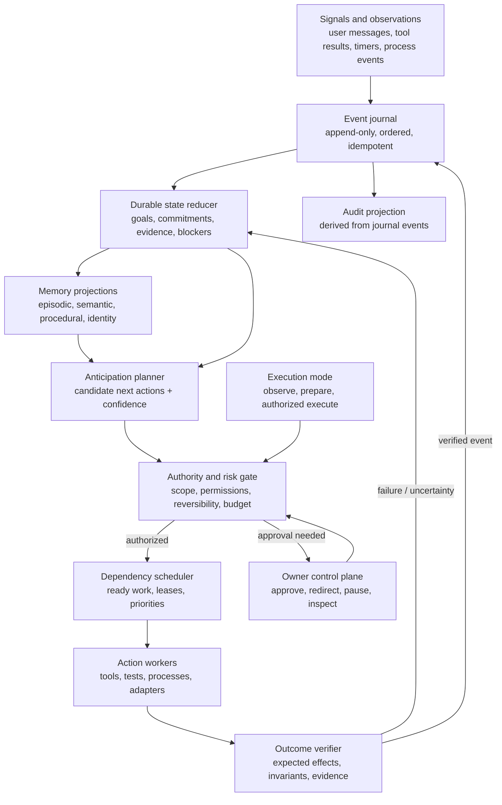

# Upgrade 6: Pre-emptive Execution Engine

## Intent

Upgrade Symbiote from a request-driven tool loop into a persistent agent runtime that can maintain commitments, anticipate useful work, act within an explicit authority envelope, and resume coherently after interruption.

“Pre-emptive” means anticipating and preparing work ahead of the next prompt. It does not mean acting on guessed intent or bypassing authorization. The engine should be proactive about work and conservative about authority.

## Architecture schematic

## State ownership

The event journal is the durable source of truth for transitions. Materialized task state, memory indexes, and dashboards are rebuildable views, not independent authorities.

The model proposes plans, action intents, and memory candidates. Deterministic controllers own validation, authorization, state transitions, scheduling, retries, cancellation, and completion. The journal records both accepted and rejected decisions so the owner can inspect why an action did or did not run.

Every active objective has a stable `taskId` and includes:

- User intent and scope, with provenance.
- Ordered or dependency-linked commitments.
- Current state, last verified checkpoint, next candidate actions, and blockers.
- Relevant evidence references and confidence.
- Authority envelope, resource budget, deadline, and cancellation generation.
- A lease or fencing token for active workers.

The runtime—not the language model—owns task lifecycle, action idempotency, retries, cancellation, and verification status. The model may propose state transitions and actions; deterministic controllers validate and record them.

## Memory fabric

Memory is partitioned by function while remaining cross-linkable:

1. **Episodic:** ordered observations, conversations, tool calls/results, and outcomes.
2. **Semantic:** extracted facts and relationships with source, timestamp, confidence, and expiry/revalidation policy.
3. **Procedural:** successful workflows, recovery patterns, and tested operating constraints.
4. **Identity/self-model:** stable preferences, declared goals, learned capability estimates, and versioned self-improvement history.
5. **Working/task memory:** current commitments, hypotheses, evidence, and checkpoints.

Each memory record carries provenance, visibility/permissions, sensitivity, validity interval, and links to originating events. Retrieval returns citations/IDs and freshness metadata; low-confidence recollections must not silently become facts. Memory extraction is separate from raw event retention so summaries never replace the source record.

## Pre-emption loop

1. Append an observation exactly once using an idempotency key.
2. Reduce it into durable task and world state.
3. Generate candidate actions from commitments, timers, blockers, expected dependencies, and learned procedures.
4. Score candidates by expected progress, urgency, confidence, resource cost, risk, and interruption impact.
5. Apply policy and authority checks before scheduling.
6. Execute eligible actions under bounded leases, budgets, and concurrency.
7. Verify stated postconditions, then append the outcome and update commitments.
8. Replan from the newly persisted state. Stop on completion, cancellation, exhausted budget, ambiguity, or approval boundary.

Preparation (inspection, test planning, cached reads) may be speculative. Mutations require an in-scope task and a declared permission. External or irreversible effects require explicit approval or a narrow standing policy. A prediction is never itself authorization.

Execution has three independently selectable modes:

- **Observe:** ingest signals and produce proposed task/action state; execute nothing.
- **Prepare:** perform bounded, policy-approved read-only preparation; queue mutations for approval.
- **Authorized execute:** run only actions inside the task's explicit authority envelope.

Mode is a hard policy input, not a planner preference. Disabling the controller or returning to observe mode must stop new claims without discarding the journal or losing already recorded outcomes.

## Self-improvement boundary

Curator and Meta^n become durable learning components, not an autonomous source-code rewrite mechanism:

- Persist observations, proposals, evaluation windows, decisions, and rule versions.
- Evaluate changes against attributable cohorts and adequate sample sizes; do not infer causation from an immediate global metric delta.
- Promote only bounded, reversible configuration/routing changes automatically.
- Require tests, provenance, rollback data, and policy approval for code changes or expanded permissions.
- Keep the baseline behavior and a rollback target available after restart.

The self-model records what has been measured and what remains uncertain. It must not assert consciousness or capability beyond evidence; continuity and adaptive behavior are engineering goals, not proof of subjective experience.

## Reliability invariants

- A completed tool call has exactly one durable result or an explicit unresolved state.
- No task is marked complete without verified postconditions.
- Restart recovery replays committed events and reconciles in-flight leases without duplicating non-idempotent actions.
- A stale worker cannot commit after cancellation or task-generation change.
- Index loss is recoverable by replay/rebuild from authoritative stores.
- Corrupt or unavailable durable state is surfaced; it is not replaced with an empty success-shaped default.
- All autonomous work is inspectable and pausable by the owner.
